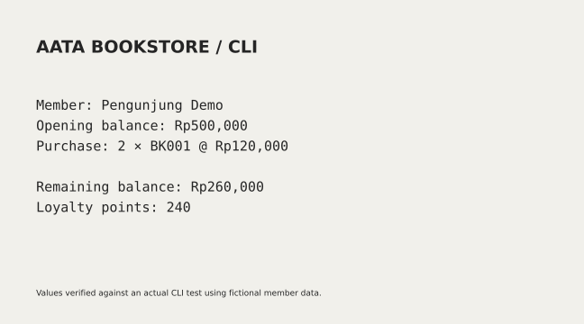

# AATA Bookstore in C++




Katalog buku, ebook, audiobook, saldo anggota, transaksi, peminjaman, dan log.

Mata kuliah: Pemrograman Berorientasi Objek.

## Hasil dan batasan

Kurasi memperbaiki EOF dan input submenu, ID ganda, penukaran poin, serta integritas peminjaman/pengembalian. Uji transaksi yang ditolak memastikan saldo, stok, dan poin tidak berubah.

Studi kasus kelompok; pembagian kontribusi asli belum tercatat. Data anggota dan catatan pinjaman masih berada di memori.

## Jalankan dari root repo

```sh
g++ -std=c++17 -Wall -Wextra projects/bookstore/main.cpp -o bookstore
./bookstore < projects/bookstore/sample-input.txt
```

Memerlukan compiler C++17. Contoh input memakai identitas fiktif. `log_aata.txt` dibuat di direktori kerja; anggota dan stok belum persisten antarsesi. Fitur memakai inheritance, virtual methods, unique_ptr, exception, dan pencatatan berkas.

Catatan pengembangan: peminjaman dicatat per anggota/buku; pengembalian ganda dan hari rencana yang tidak cocok ditolak. Input nonnumerik ditangani, saldo awal/top-up diperiksa, dan diskon hanya ditukar per blok 100 poin. Penyimpanan antarsesi belum dibuat. README sengaja tidak menyebut siap produksi.

## Asal dan kontribusi

Berasal dari arsip PBO Brian yang menyertakan brief kelompok. Tidak diklaim sebagai karya individu sepenuhnya.

Sumber arsip: Laptop · Semester 3 / PBO / 13. Berkas asli tidak diubah. Perubahan kurasi dibuat pada November 2026.
