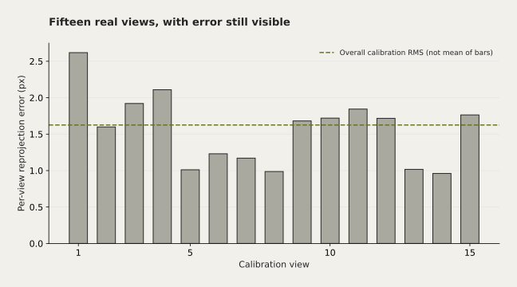

# Chessboard Camera Calibration




Kalibrasi chessboard 9×6, error per-view, diagnosis cakupan frame, dan ekspor parameter.

Mata kuliah: Visi Komputer.

## Hasil dan batasan

CLI v2 dijalankan ulang pada 15 foto asli beresolusi 2448×2048. RMS reprojection error 1,6258 px. Parameter serta error per-view disimpan dalam reference-results/camera_parameters.json.

Koefisien distorsi besar; stabilitas fit perlu diperiksa dengan sudut dan cakupan papan yang lebih beragam. Ukuran kotak serta focal length nominal lensa belum diukur. RMS saja tidak membuktikan akurasi pose dunia nyata.

## Jalankan dari root repo

```sh
python -m pip install -r projects/camera-calibration/requirements.txt
python projects/camera-calibration/calibrate.py --images /path/to/checkerboard-photos --output calibration-results
```

Pakai papan 10×7 kotak (=9×6 inner corners), minimal tiga foto valid pada resolusi sama. CLI memakai `calibrateCameraExtended` untuk RMS dan error per-view; kandidat outlier dilaporkan dan tidak otomatis dibuang. Nilai pixel pitch dan spesifikasi model di blok `CAMERA_SPEC` diwarisi dari notebook dan perlu dicocokkan dengan perangkat yang benar. Konversi fisik bergantung pada pixel pitch, resolusi, dan ukuran kotak; angka focal length body tidak menggantikan spesifikasi lensa.

Foto asli tidak disertakan. Parameter dan hasil baru disimpan ke folder `--output`, terpisah dari foto masukan.

## Asal dan kontribusi

Dikurasi dari notebook dalam arsip tugas Brian. Spesifikasi kamera ditandai sebagai asumsi konfigurasi.

Sumber arsip: Laptop dan Google Drive · Computer Vision / Calibration · Visi_Komputer / Tugas. Berkas asli tidak diubah. Perubahan kurasi dibuat pada November 2026.
