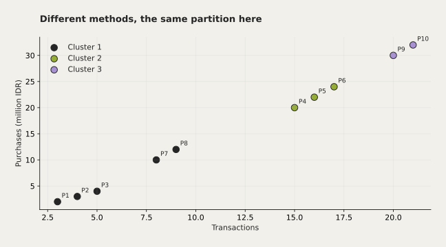

# Clustering: Centroid, Fuzzy & Hierarchy




Melacak iterasi K-Means, Fuzzy C-Means, complete/single linkage, dan silhouette manual.

Mata kuliah: Pembelajaran Mesin.

## Hasil dan batasan

Perbandingan partisi dan silhouette dapat dijalankan ulang dari dataset kecil dalam kode.

Data latihan kecil; nilai silhouette tidak membuktikan segmentasi pelanggan nyata.

## Jalankan dari root repo

```sh
python -m pip install -r projects/clustering/requirements.txt
python projects/clustering/experiment.py
```

Jalankan notebook lewat Jupyter atau gunakan ekspor Python. Program menulis dendrogram ke `hasil/` dan menampilkan perhitungan. Manual silhouette diperiksa terhadap scikit-learn. ID mahasiswa dan output notebook lama dibuang dari salinan publik.

## Asal dan kontribusi

Notebook tugas mencantumkan Brian. Data latihan tertanam dipertahankan.

Sumber arsip: Laptop · Semester 5 / Machine Learning / Tugas Clustering. Berkas asli tidak diubah. Perubahan kurasi dibuat pada November 2026.
