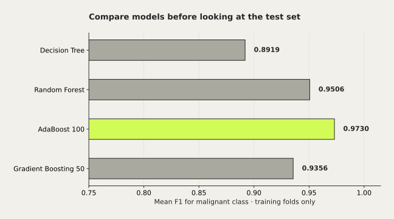

# Ensemble Learning: Voting & Boosting




Hard/soft voting, pembaruan bobot AdaBoost, serta perbandingan model pohon pada dataset publik.

Mata kuliah: Pembelajaran Mesin.

## Hasil dan batasan

AdaBoost 100: F1 test 0,9383 untuk kelas malignant; dipilih dari CV.

Dataset Wisconsin Breast Cancer, bukan churn pelanggan. Eksperimen pendidikan, belum tervalidasi klinis.

## Jalankan dari root repo

```sh
python -m pip install -r projects/ensemble-learning/requirements.txt
python projects/ensemble-learning/experiment.py
```

Dataset berasal dari `sklearn.datasets.load_breast_cancer`, bukan unggahan pasien atau data churn. Kelas positif untuk F1 adalah malignant (0). Test 114 sampel, termasuk 42 malignant; AdaBoost 100 menghasilkan TP=38, FN=4, FP=1, TN=71. Pilihan estimator memakai 5-fold CV pada train; perbandingan test banyak model bersifat deskriptif, bukan bukti keunggulan universal.

[Dokumentasi dataset](https://scikit-learn.org/stable/datasets/toy_dataset.html#breast-cancer-dataset).

## Asal dan kontribusi

Paket tugas Brian; tidak diklaim sebagai produk diagnosis.

Sumber arsip: Google Drive · Semester_5 / Machine Learning / Tugas TM 8 / Ensemble_Learning. Berkas asli tidak diubah. Perubahan kurasi dibuat pada November 2026.
