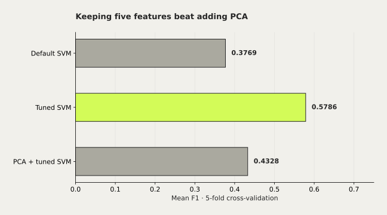

# Machine Failure: SVM & PCA




Membandingkan SVM default, tuning C, dan PCA pada lima fitur sensor AI4I.

Mata kuliah: Pembelajaran Mesin.

## Hasil dan batasan

F1 test 0,5714; recall 0,4412. Model menang tanpa PCA.

Dataset sintetis; 38 dari 68 kasus gagal masih terlewat. Bukan prediksi remaining useful life.

## Jalankan dari root repo

```sh
python -m pip install -r projects/machine-failure/requirements.txt
python projects/machine-failure/experiment.py
```

Dataset yang dicari: `data/predictive_maintenance.csv`, di dalam folder proyek. Jika belum tersedia, program mengunduh versi Kaggle. Unduhan membutuhkan jaringan. Tidak ada kredensial Kaggle di repo. SHA-256 sumber: `9f0ede0b6fc33edacccfa1924e6430f92bd33ecce6e895543cd228c3a55ff10b`.

Validasi: split stratified 80/20, seed 42, 5-fold CV. Scaling dan PCA berada di dalam pipeline. Kolom `Failure Type` tidak menjadi fitur. Model dipilih dari CV sebelum test; tuning tidak dijamin memberi estimasi CV yang bebas bias seleksi.

Sumber data: [Kaggle](https://www.kaggle.com/datasets/shivamb/machine-predictive-maintenance-classification), [AI4I 2020](https://doi.org/10.24432/C5HS5C).

## Asal dan kontribusi

Tugas atas nama Brian; kurasi mempertahankan metode dan hasil sumber.

Sumber arsip: Laptop · Semester 5 / Machine Learning / TM 191026. Berkas asli tidak diubah. Perubahan kurasi dibuat pada November 2026.
