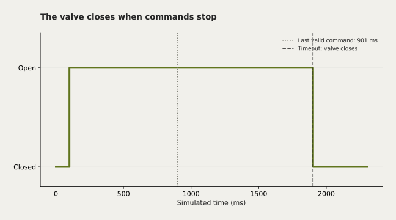

# Two-Board Serial Irrigation




Dua mikrokontroler bertukar perintah kelembapan untuk mengendalikan katup.

Mata kuliah: Sistem Tertanam & IoT.

## Hasil dan batasan

Kurasi menambahkan katup tertutup saat startup, input tak valid, atau komunikasi terputus >1 detik.

Uji logika host tidak menggantikan uji dua board. Persentase berasal dari pemetaan ADC; kalibrasi sensor dan driver katup tetap diperlukan.

## Jalankan dari root repo

```sh
g++ -std=c++17 projects/serial-irrigation/test_control.cpp -o irrigation-test
./irrigation-test
```

Board A: sensor analog A0. Board B: output kontrol katup D9. Pada keduanya SoftwareSerial RX=D2, TX=D3, 9600 baud. Hubungkan TX A ke RX B dan ground bersama; samakan level tegangan. Gunakan driver relay/MOSFET dan proteksi beban yang sesuai; pin mikrokontroler hanya mengirim sinyal kontrol.

Unggah masing-masing sketch melalui Arduino IDE dengan library SoftwareSerial. Header `control.h` sudah disertakan di setiap folder sketch agar dapat dibuka langsung oleh Arduino IDE. Skema input asli: ADC dipetakan linear 0–1023 ke 0–100, siram jika <30. Perkalian memakai tipe long karena 1023 × 100 melampaui rentang int 16-bit pada AVR. Masukan di luar 0–1023 menghasilkan perintah tutup dan penanda telemetri −1. Arah dan rentang sensor nyata perlu dikalibrasi. Ini komunikasi serial lokal, belum terhubung ke internet. Uji host memeriksa ambang, komunikasi putus, perintah tidak valid, dan rollover waktu.

## Asal dan kontribusi

Dikembangkan dari sketch transmitter dan receiver dalam folder tugas Brian.

Sumber arsip: Laptop · Semester 4 / IOT / tugas atas nama Brian. Berkas asli tidak diubah. Perubahan kurasi dibuat pada November 2026.
